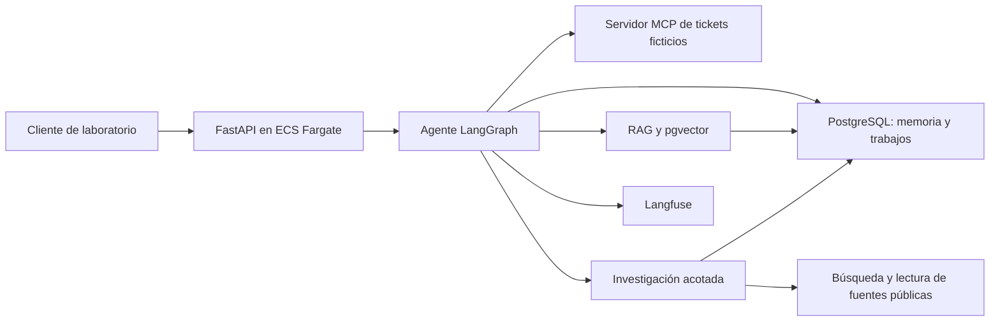

# Plan de preparación de S16 a S20 de AI Engineer

Revisión: 17 de octubre de 2026. Profesor: José Antonio. Todas las sesiones se imparten de 18:30 a 20:00, zona Europe/Madrid, incluidas las preguntas.

El objetivo es preparar cinco clases, impartidas en siete directos, aprovechando el caso de soporte de S5–S8, la observabilidad de S6 y el corpus y las decisiones de RAG e investigación de S10–S12. La propuesta utiliza una base Python común y paquetes ejecutables por sesión. Cada grupo recibe un punto de partida completo, aunque la sesión anterior la haya impartido otro profesor.

Este documento fija el trabajo de preparación. Los repositorios, las demostraciones y las presentaciones nuevas descritos aquí todavía deben construirse y ensayarse. La revisión del 17 de octubre comprendió el temario original guardado localmente, los dos DOCX originales de ejercicios recuperados desde Gmail, la documentación técnica indicada al final y los archivos existentes. No incluyó ejecución cloud ni llamadas de inferencia.

## 1. Calendario y alcance acordado

| Sesión | Fecha y grupo | Tema | La encuesta inicial evalúa |
|---|---|---|---|
| S16 | Jueves 12/11 · M/J | Cloud deployment y Docker | S15 del 10/11 |
| S17 | Martes 17/11 · M/J | Bedrock y Lambda | S16 del 12/11 |
| S17 | Lunes 23/11 · L/X | Bedrock y Lambda | S16 del 18/11 |
| S19 | Martes 24/11 · M/J | Evaluación y testing | S18 del 19/11 |
| S18 | Miércoles 25/11 · L/X | CI/CD y monitorización | S17 del 23/11 |
| S19 | Lunes 30/11 · L/X | Evaluación y testing | S18 del 25/11 |
| S20 | Miércoles 02/12 · L/X | Proyecto final | S19 del 30/11 |

El calendario procede de la [guía de clases](/Users/jose/Documents/the-power/GUIA-DE-CLASES-2026.md) y los calendarios de [L/X](/Users/jose/Documents/the-power/3-rag/corpus/sources/cohorts/calendario-lx.md) y [M/J](/Users/jose/Documents/the-power/3-rag/corpus/sources/cohorts/calendario-mj.md).

Hay tres niveles de alcance que deben mantenerse identificables:

- **Temario de thePower:** contenidos y objetivos de cada directo.
- **Ejercicios redactados por José y enviados a la escuela:** requisitos concretos de S16–S19. Las 4–9 horas de dedicación de esos ejercicios son trabajo autónomo del alumno; no deben meterse enteras en los 90 minutos del directo.
- **Decisiones de este plan:** caso de uso, estructura del futuro repositorio, tiempos, demostraciones, formato de materiales y propuesta de S20.

Laura indicó el 19 de agosto que los enunciados deben estar en la plataforma de antemano para no consumir el directo explicándolos íntegramente. Reservaremos un breve cierre para conectar la demo con la entrega. S20 tiene temario y entrega de proyecto final, pero en las fuentes consultadas no consta una rúbrica, fecha límite ni definición inequívoca de construcción, revisión o defensa.

## 2. Base común y reutilización

### Caso docente

Usar un asistente de soporte de una plataforma ficticia. En S16 y S17 recibe una incidencia y devuelve `categoria`, `prioridad` y `respuesta`. Se conservan las categorías de S7/S8: `acceso`, `facturacion`, `tecnico`, `consulta`; prioridades: `alta`, `media`, `baja`.

En S19 responde preguntas documentales sobre AetherCloud. S20 une ambas capacidades: clasifica una incidencia, consulta un ticket ficticio, recupera documentación y, cuando hace falta información pública adicional, inicia una investigación acotada. Los tickets de S5 se pueden adaptar al contexto AetherCloud conservando sus originales. La información pública nunca sustituye una política interna ausente.

### Material existente que se puede aprovechar

| Origen verificado | Reutilización concreta | Adaptación necesaria |
|---|---|---|
| [Grafo de soporte S5](/Users/jose/Documents/the-power/1-langGraph/app/soporte/graph.py) | Estado explícito, rutas, inyección de modelo y herramientas, límites por turno | Usar en S20; separar la lógica del lanzador CLI y conectarla a FastAPI |
| [Herramientas S5](/Users/jose/Documents/the-power/1-langGraph/app/soporte/tools.py) y `datos/soporte/` | Tickets y artículos ficticios, validación de argumentos, escenarios de fallo | Adaptar datos al caso común; exponer una herramienta mediante MCP en S20 |
| [Persistencia S5](/Users/jose/Documents/the-power/1-langGraph/app/soporte/persistence.py) | Continuidad tras reinicio e independencia entre hilos | El código actual usa SQLite; S20 debe incorporar PostgreSQL y comprobar la asociación usuario–conversación |
| [Telemetría S6](/Users/jose/Documents/the-power/1-langGraph/app/soporte/telemetry.py) y [guía S6](/Users/jose/Documents/the-power/1-langGraph/S6-README.md) | Request/query ID, modelo, versión de prompt, trazas, masking y consumo desconocido | Extraer la integración Langfuse necesaria; verificarla contra el lock nuevo, sin arrastrar la TUI ni exigir LangSmith |
| [Contrato y validador S7/S8](/Users/jose/Documents/the-power/2-modelos/curso/common.py) | Taxonomía, datos sintéticos, conservación de originales y criterios de respuesta | Crear un módulo ligero de contrato. No importar `common.py` completo: carga configuración y contiene constantes del experimento Qwen |
| [CI de modelos](/Users/jose/Documents/the-power/2-modelos/.github/workflows/checks.yml) | Locks, acciones fijadas, pruebas sin proveedores de pago | Adaptar a pytest, Docker, ECR, OIDC y staging; verificar de nuevo los SHA elegidos |
| [Corpus AetherCloud](/Users/jose/Documents/the-power/3-rag/lab/corpus/sources) y [esquema pgvector](/Users/jose/Documents/the-power/3-rag/lab/schema.sql) | Diez documentos ficticios, IDs, metadatos, `vector(768)` e HNSW | Crear ingesta/consulta Python con proveedores reales y pruebas propias; conservar procedencia de los datos |
| [Protocolo de comparación RAG](/Users/jose/Documents/the-power/3-rag/material/comparacion/protocolo.md) | Congelar corpus, configuración, preguntas y parámetros; conservar fallos | Preparar un conjunto nuevo de S19 que no se haya usado para ajustar las demos anteriores |
| [Núcleo de investigación S12](/Users/jose/Documents/the-power/3-rag/packages/research/src) y [ensayo documentado](/Users/jose/Documents/the-power/3-rag/docs/s12-cloud-deployment.md) | Separación de plan, búsqueda, lectura, evidencia y respuesta; límites; informe parcial | Portar solo el recorrido mínimo a Python. D1, R2, Workflows y código TypeScript no se importan directamente en el proyecto Python |
| [Recursos visuales existentes](/Users/jose/Documents/the-power/1-langGraph/material/assets) | Logo, fondo y QR original de AI Engineer | Usar identidad visual común; adaptar fecha, sesión y referencia a la clase anterior |

El laboratorio actual `3-rag/lab` sirve como referencia de flujo, datos y pruebas. Su CLI selecciona embeddings deterministas y el generador por defecto es extractivo; poner un nombre de modelo en la configuración no acredita una llamada a ese proveedor. Sus cifras de 16/20 y 17/20 no se trasladarán como resultados del RAG Python ni como línea base de S19.

### Organización propuesta

Crear después un repositorio independiente, provisionalmente `4-produccion-ia`, dentro de the-power. Mantener intactos los repositorios de las clases anteriores. Un único repositorio nuevo facilita compartir contratos sin introducir una dependencia de la estructura privada de este Mac.

Estructura prevista, todavía no creada:

```text
4-produccion-ia/
  src/curso_ia/
    contratos/       # Incidencias, respuestas y errores
    soporte/         # Caso común y proveedores
    api/             # FastAPI, salud, clasificación y metadatos
    serverless/      # Handler Lambda y adaptador Bedrock
    rag/             # Corpus, ingesta, recuperación y generación Python
    agente/          # Grafo, herramientas, memoria y research de S20
  evaluador/         # Entorno aislado de Ragas y contrato JSONL
  infra/             # Stacks separados por práctica
  datos/             # Datos sintéticos de desarrollo y corpus
  tests/             # Contratos, integración y evaluaciones marcadas
  scripts/           # Preflight, demo, evidencia, costes y limpieza
  material/S16/ ... material/S20/
  .github/workflows/
```

Cada sesión tendrá una versión inicial y una versión resuelta identificadas por commit, junto con instrucciones de descarga. No será necesario hacer cambios destructivos para volver atrás en clase. Los scripts y comandos definitivos se fijarán durante la implementación y se ensayarán desde una copia limpia. Los nombres de comandos que aparecen a continuación son contratos previstos, no comandos ya disponibles.

Python 3.12 será el punto de partida por continuidad con S5–S8. El entorno de Ragas quedará aislado del runtime del agente para poder respetar `ragas==0.4.3` y `langchain-community==0.3.31` sin forzar su árbol de dependencias sobre toda la aplicación. Los intercambios con el evaluador se harán mediante JSONL versionado.

### Contratos y criterios compartidos

- `GET /health`: salud del proceso y versión; no invoca un modelo ni demuestra por sí solo que la integración funciona.
- `POST /clasificar`: incidencia ficticia validada; devuelve clasificación y respuesta, con metadatos de ejecución fuera del texto del modelo.
- Identificar modelo, versión de aplicación, versión de prompt, request ID, duración y consumo. Los valores desconocidos permanecen nulos; los costes estimados llevan fuente y fecha.
- Los tests normales usan dobles y no consumen APIs de pago. Las ejecuciones reales tienen entrada explícita, límite, recibo y destino de resultados.
- Mantener por separado la evidencia local, la de GitHub Actions, el digest publicado, la identidad desplegada y la comprobación funcional.
- No enseñar resultados de replay como una llamada actual. Conservar el resultado anterior como respaldo, con fecha, entrada y configuración.
- Cada stack y recurso de laboratorio tendrá propietario y sesión identificables. Preparar limpieza por inventario de recursos propios, conservando los recursos compartidos.

## 3. S16 Cloud deployment y Docker

**Fecha:** 12 de noviembre, M/J. **Resultado que debe comprender el alumno:** cómo pasa una API de su máquina a un contenedor en AWS, qué papel cumplen red y permisos y cómo comprobar y retirar lo desplegado.

### Cobertura del temario y del ejercicio

| Requisito | Cómo se explica o demuestra |
|---|---|
| AWS básico y comparación con Azure/GCP | Mapa de cómputo, almacenamiento, red, identidad y modelos gestionados; situar la demo en ese mapa |
| Docker | Dockerfile pequeño, usuario no root, dependencias bloqueadas, `.dockerignore`, arquitectura y configuración externa |
| FastAPI, salud e IA | API ya comprensible sobre el contrato de soporte; una llamada válida y un error de entrada |
| ECR y ECS/Fargate | Imagen identificable, task definition, servicio/tarea, logs y lectura del digest efectivo |
| Secretos y roles | Secreto referenciado desde la tarea; distinguir execution role y task role |
| Red de laboratorio | Puerto de API limitado a la IP del profesor, salida necesaria y contenido sintético |
| Costes y retirada | Estimación de 730 horas y coste de la sesión; inventario antes/después de limpiar |

### Qué construir y preparar

1. Extraer la clasificación de incidencias de S7/S8 a un servicio Python ligero. La API solo necesita el contrato, instrucciones y un adaptador de modelo. No necesita pesos, LoRA, GPU, LangGraph ni una base de datos.
2. Añadir FastAPI, validación de entrada/salida, `/health`, request ID, versión y errores de proveedor controlados. Elegir y fijar un proveedor ya utilizado en el curso después de comprobar acceso; el ejercicio no impone un modelo concreto.
3. Preparar Dockerfile reproducible, `.dockerignore`, healthcheck y ejecución como usuario no root. Fijar una arquitectura para la práctica; preferencia inicial `linux/amd64` para que coincidan profesor, CI y Fargate.
4. Preparar infraestructura declarativa mínima y legible: ECR, logs, tarea/servicio Fargate, roles, security group y referencias a la red del laboratorio. Usar CloudFormation para evitar añadir un lenguaje y una plataforma de estado diferentes al objetivo de la clase. Si el laboratorio ya tiene una convención IaC, adaptar esa pieza sin cambiar el resultado docente.
5. Preparar el secreto fuera del código y la imagen. Si se usa una KMS propia, incluir el descifrado en la identidad que realmente lo necesita.
6. Ensayar despliegue, detección de disponibilidad, GET de salud y POST real. Guardar commit, digest, task definition, arquitectura, hora y respuesta. Preparar una imagen previa para continuar si el build tarda.
7. Preparar hoja de cálculo o tabla con las fórmulas: cómputo por 730 horas, almacenamiento de imagen, logs, IPv4 y tráfico; inferencia aparte. Usar tarifas de la región elegida con fecha. No asumir que el nivel gratuito elimina esos costes.
8. Ensayar la retirada de recursos propios y el inventario residual. Escalar a cero no elimina por sí solo imágenes, logs o secretos.

### Guion de 90 minutos

| Hora | Minutos | Actividad y prueba visible |
|---|---:|---|
| 18:30–18:35 | 5 | QR de S15 y objetivo: qué significa que una aplicación esté desplegada |
| 18:35–18:47 | 12 | Mapa cloud y AWS/Azure/GCP; cómputo, storage, red, identidad y servicios de IA |
| 18:47–19:02 | 15 | Abrir la API, validar una incidencia, leer Dockerfile y arrancar el contenedor local |
| 19:02–19:20 | 18 | Publicar la imagen y seguir task definition, secreto y arranque en Fargate |
| 19:20–19:32 | 12 | Comprobar salud, petición real, versión y logs; diagnosticar una entrada inválida |
| 19:32–19:42 | 10 | Resolver el cálculo de 730 horas y comparar con una demo breve |
| 19:42–19:50 | 8 | Retirada guiada e inventario; diferencia entre parar y eliminar recursos cobrables |
| 19:50–20:00 | 10 | Preguntas y conexión con la entrega autónoma |

El bloque de despliegue tiene un corte: si a las 19:12 no está disponible la nueva tarea, continuar con el servicio ensayado o el recibo grabado y explicar dónde quedó la ejecución. No consumir el bloque de costes y limpieza esperando una consola.

### Material docente y participación

Preparar 10 diapositivas principales: objetivo/QR; mapa cloud; contenedor e imagen; ECR/ECS/Fargate; red; roles y secretos; flujo de despliegue; lectura de evidencias; costes; ejercicio. Añadir hasta cuatro de consulta sobre arquitectura ARM/AMD, HTTPS, red privada y limpieza.

El alumno debe predecir qué falla si la imagen y la tarea tienen arquitecturas distintas, localizar quién lee el secreto y distinguir una API saludable de una API capaz de invocar el modelo. Preparar una ficha de diagnóstico con imagen, red, permisos y proveedor como cuatro comprobaciones separadas.

Paquete: PPTX/PDF con notas, guion, starter y solución, Dockerfile explicado, plantilla IaC, comandos copiados y ensayados, tres peticiones sintéticas, tabla de costes, checklist y recibo anterior de respaldo. El enunciado mantiene sus 4–6 horas de trabajo autónomo.

### Criterio de cierre

- [ ] Una copia limpia ejecuta el contenedor y pasa los tests sin secretos.
- [ ] `/health` y una petición real responden en AWS; el digest desplegado es el esperado.
- [ ] Imagen y repositorio carecen de secretos y el contenedor usa usuario no root.
- [ ] Red, execution role y task role se pueden explicar en el diagrama y en la configuración.
- [ ] La estimación incluye todos los recursos utilizados y separa inferencia.
- [ ] La limpieza y el inventario residual han sido ensayados.
- [ ] El recorrido cabe en 90 minutos, con respaldo de despliegue disponible.

## 4. S17 Serverless AI con Bedrock y Lambda

**Fechas:** 17 de noviembre M/J y 23 de noviembre L/X. **Resultado que debe comprender el alumno:** cómo cambia la operación de la misma clasificación cuando la ejecutan API Gateway, Lambda y Bedrock, y cómo medir esa decisión.

### Cobertura del temario y del ejercicio

| Requisito | Cómo se explica o demuestra |
|---|---|
| Serverless y alternativas | Comparar el recorrido con S16 y situar alternativas de Azure/GCP por función |
| API Gateway HTTP API con IAM | Una llamada sin firma rechazada y una llamada SigV4 válida |
| Lambda y Bedrock | Handler breve que valida, invoca, comprueba la salida y devuelve JSON |
| Perfil europeo y permisos | Perfil/modelo/regiones configurados; permiso `bedrock:InvokeModel` y autorización del llamante |
| Robustez | Entrada inválida, proveedor lento/simulado, salida inválida, límites de tokens y concurrencia |
| Latencia | Duración total y del modelo; cold start solo con evidencia; cinco llamadas calientes |
| Coste | Estimación de 1.000 solicitudes a partir de un número pequeño de llamadas observadas |

### Qué construir y preparar

1. Reutilizar los contratos y casos de S16. Crear un handler Lambda pequeño que llame al servicio de clasificación; no envolver innecesariamente toda FastAPI en Lambda.
2. Implementar el adaptador Bedrock con el SDK de AWS. Conservar `BEDROCK_MODEL_ID`; tratar `eu.amazon.nova-2-lite-v1:0` como referencia del enunciado hasta comprobar su acceso en la cuenta y región. No sustituirlo silenciosamente.
3. Solicitar salida mediante `toolConfig` o el mecanismo compatible observado y validarla de nuevo. Aclarar por qué S8 evitaba ayudas de formato para medir al modelo y esta API sí las utiliza.
4. Preparar una HTTP API con IAM y una plantilla de rol de Lambda limitada al perfil y modelos de destino. Preparar también los permisos `execute-api:Invoke` de la identidad que hace la llamada.
5. Preparar un cliente de demostración que firme con el SDK y la cadena de credenciales temporales. Evitar mostrar claves en comandos, historial o pantalla. La firma SigV4 es el concepto; el ejercicio también permite curl/awscurl.
6. Fijar tamaño máximo de entrada, límite de salida, reintentos explícitos y concurrencia acotada. El timeout del proveedor debe permitir devolver un error antes del timeout de Lambda y del corte de API Gateway; comprobar los límites de la configuración concreta durante el ensayo.
7. Guardar una serie con request ID, tiempo total, tiempo del modelo, tokens y estado. Relacionar el identificador con los logs de Lambda. Capturar `Init Duration` si aparece; registrar su ausencia si no se consigue un cold start.
8. Preparar las tarifas fechadas y fórmulas para 1.000 peticiones, separando Lambda, API Gateway, Bedrock y logs. Conservar la muestra real pequeña; no ejecutar 1.000 llamadas.

### Guion de 90 minutos

| Hora | Minutos | Actividad y prueba visible |
|---|---:|---|
| 18:30–18:35 | 5 | QR de S16 y recuperación del contrato de la API |
| 18:35–18:47 | 12 | Serverless frente a contenedor; límites y alternativas cloud |
| 18:47–19:00 | 13 | Leer handler, validación y petición Bedrock; seguir el diagrama de IAM |
| 19:00–19:15 | 15 | Petición sin firma y petición firmada; observar la respuesta JSON |
| 19:15–19:28 | 13 | Entrada inválida, salida inválida y timeout controlado con pruebas preparadas |
| 19:28–19:40 | 12 | Examinar cold/warm y ejecutar o reproducir cinco solicitudes calientes |
| 19:40–19:50 | 10 | Cálculo de 1.000 peticiones, decisión de arquitectura y limpieza |
| 19:50–20:00 | 10 | Preguntas y criterios de entrega |

Preparar el despliegue antes de la clase. Durante el directo mostrar el código, la configuración desplegada y llamadas pequeñas. No dedicar el tiempo de medición a crear permisos de cuenta o conseguir acceso al modelo.

### Material docente y participación

Preparar 10–12 diapositivas principales: objetivo/QR; funciones y servicios; ruta HTTP; IAM de llamante y Lambda; perfil de modelo; contrato de salida; límites; cold/warm; coste; alternativas; ejercicio. Notas específicas para los dos grupos.

Preguntas: qué identidad autoriza API Gateway, quién puede invocar Bedrock, por qué la primera llamada no demuestra un cold start y cuándo conviene volver a un contenedor. Mini ejercicio: clasificar un 403, un error de validación y un timeout por la capa responsable.

Paquete: starter completo, solución, IaC, cliente firmado, matriz de errores, tabla de latencias y costes, datos sintéticos y replay fechado. Mantener 4–6 horas para el ejercicio autónomo. El 22 de noviembre hacer un preflight breve para L/X sin cambiar el contrato ya utilizado en M/J.

### Criterio de cierre

- [ ] La llamada sin firma falla y la firmada funciona con credenciales temporales.
- [ ] El perfil y las regiones efectivas se han comprobado; IAM queda limitado a lo utilizado.
- [ ] La Lambda devuelve JSON validado o errores controlados, sin filtrar respuestas internas.
- [ ] Hay cinco llamadas calientes registradas; el cold start está acreditado o declarado ausente.
- [ ] Los límites y costes se explican con datos y supuestos visibles.
- [ ] El starter permite a L/X seguir la clase sin disponer de nuestra S16.

## 5. S18 CI/CD y monitorización

**Fecha:** 25 de noviembre, L/X. **Resultado que debe comprender el alumno:** cómo demostrar que un cambio defectuoso queda bloqueado, que se despliega exactamente el artefacto probado y que se puede volver a una versión conocida.

### Cobertura del temario y del ejercicio

| Requisito | Cómo se explica o demuestra |
|---|---|
| CI/CD, entornos y GitHub Actions | Tres flujos legibles: PR, publicación desde main y despliegue manual a staging |
| Tests automáticos | Caso válido, entrada inválida y proveedor fallido; PR roja con un fallo deliberado |
| Artefacto inmutable | Commit → checks → imagen → digest → task definition; deploy y rollback sin reconstruir |
| OIDC y secretos | Credenciales temporales; `aud`, `sub` real y restricciones de environment |
| Logging, monitoring, APM y errores | Request ID, versión, duración y estado; recorrido de un error desde la petición al log; métricas básicas |
| Despliegues y datos | Rolling/canary como estrategias; expand/contract; backup y restauración, distinguiendo aplicación y datos |
| Recuperación | Segunda versión, error observable y retorno al digest anterior con nueva comprobación funcional |

### Qué construir y preparar

1. Entregar la API resuelta de S16 como base autocontenida a L/X. Reutilizar la tarea Fargate en un stack de staging propio; no depender de recursos todavía activos del 12 de noviembre.
2. Preparar `ci-pr`: lock, análisis, pytest y build Docker, sin credenciales cloud. Casos obligatorios del ejercicio y una modificación pequeña que produzca rojo de forma comprensible.
3. Preparar `publish-main`: repetir checks sobre el commit integrado; construir una vez, publicar en ECR y guardar digest, commit, arquitectura y resultado. Fijar todas las acciones externas a SHA completos verificados.
4. Preparar `deploy-staging`: `workflow_dispatch`, ejecución desde main y digest explícito previamente publicado. Comprobar que el digest pertenece al repositorio y a un build validado; registrar task definition anterior y nueva. No reconstruir en este job.
5. Preparar proveedor OIDC, rol y environment antes del directo. Leer el formato real del `sub` emitido sin imprimir el token y configurar la confianza para ese environment, junto con `aud=sts.amazonaws.com`. Las ramas permitidas del environment y el guard del workflow deben impedir despliegues desde ramas no autorizadas. Separar permisos de publicación y despliegue cuando sea práctico.
6. Resolver la comprobación de red: el runner alojado de GitHub no podrá llamar sin más a una API restringida a la IP del profesor. Propuesta: ejecutar una tarea efímera de smoke dentro de la VPC, autorizada por referencia de security group, que compruebe salud, versión y petición funcional por la dirección privada. El workflow espera su exit code y conserva evidencia saneada. No abrir el puerto al mundo para que pase el check.
7. Preparar dos imágenes A y B. B tendrá una regresión docente controlada y observable en una ruta de prueba, con un contrato que los tests existentes no cubrían; explicar esa limitación. Tras observar el fallo, volver al digest A y repetir salud y petición funcional. Añadir después el test que faltaba como reflexión, sin convertir la clase en una sesión larga de programación.
8. Construir un panel mínimo con errores y latencia, y un recorrido request ID → log de aplicación → llamada de proveedor. Diferenciar estos logs de las trazas semánticas de Langfuse. No prometer una integración APM que no se haya implementado.
9. Preparar un ejemplo visual de migración compatible y un procedimiento de backup/restauración. La práctica obligatoria no necesita añadir una base de datos; la demostración de restauración con datos ficticios es una ampliación si está preparada.

### Guion de 90 minutos

| Hora | Minutos | Actividad y prueba visible |
|---|---:|---|
| 18:30–18:35 | 5 | QR de S17 y objetivo de entrega verificable |
| 18:35–18:47 | 12 | CI/CD, staging y cadena commit–digest–servicio |
| 18:47–19:02 | 15 | PR con fallo: localizar el test rojo; corregir y leer el resultado preparado |
| 19:02–19:15 | 13 | OIDC, environment y publicación de una imagen validada |
| 19:15–19:30 | 15 | Despliegue por digest y smoke dentro de la red del laboratorio |
| 19:30–19:42 | 12 | Error en B, logs, rollback a A y comprobación de recuperación |
| 19:42–19:50 | 8 | Estrategias progresivas, datos, backups y límites del rollback |
| 19:50–20:00 | 10 | Preguntas y evidencias exigidas en la entrega |

Tener abiertos runs previos terminados y A/B publicados. Si GitHub o ECS supera el tiempo de corte, recorrer la evidencia guardada y dejar visible qué ejecución sigue pendiente. No declarar un deploy correcto solo porque el job esté verde.

### Material docente y participación

Preparar 12 diapositivas principales y anexos con trust policy, workflow y secuencia de recuperación. Preguntas: qué prueba un build, qué identifica un digest, por qué environment cambia `sub` y qué ocurre con los datos al volver a A. Mini ejercicio: reconstruir una ejecución a partir de commit, digest, task definition y request ID.

Paquete: starter de S16, solución con tres workflows, tests, imágenes A/B identificadas, recibos, diagrama OIDC, panel/logs de respaldo, checklist de recuperación y limpieza. Mantener las 6–8 horas del ejercicio autónomo con infraestructura inicial preparada.

### Criterio de cierre

- [ ] Una PR defectuosa queda roja y no obtiene credenciales de despliegue.
- [ ] Main repite checks y publica un digest atribuible al commit verificado.
- [ ] Dispatch desde una rama no autorizada queda bloqueado.
- [ ] La confianza OIDC coincide con el environment y los claims reales de la cuenta.
- [ ] Deploy y rollback usan digests existentes y conservan la identidad del artefacto.
- [ ] Salud y una petición funcional se verifican después de ambos cambios.
- [ ] El smoke tiene una ruta de red ensayada y no necesita acceso público amplio.
- [ ] Existe un fallo localizable mediante request ID y una recuperación documentada.

## 6. S19 Evaluación y testing de sistemas de IA

**Fechas:** 24 de noviembre M/J y 30 de noviembre L/X. **Resultado que debe comprender el alumno:** cómo distinguir errores de recuperación, generación y evaluación, y cómo detectar una regresión sin manipular el test.

### Cobertura del temario y del ejercicio

| Requisito | Cómo se explica o demuestra |
|---|---|
| RAG completo Python/pgvector | Reconstrucción desde documentos en bruto y base de práctica vacía |
| Evaluación de recuperación | `precision@5` y `recall@5` por documento; deduplicación y denominadores explícitos |
| Evaluación de generación | Faithfulness y AnswerRelevancy con el evaluador aislado y su configuración congelada |
| Corpus, validación y test | Al menos ocho documentos; test nuevo 14+6; validación separada; preguntas fuera del índice |
| Comparación controlada | Dos prompts, mismo retrieval/modelos/evaluador y todos los demás parámetros |
| Revisión humana y cobertura | Al menos cinco casos revisados; fallos del evaluador, NaN, vacíos y rechazos incorrectos visibles |
| Tests y observabilidad | Pytest normal sin red, evaluaciones marcadas, Langfuse y control de regresión |

### Qué construir y preparar

1. Crear el RAG Python mínimo reutilizando los diez documentos AetherCloud y la idea de IDs/versiones del laboratorio. Implementar ingesta real, chunking, embeddings, pgvector, consulta, umbral previo y generación con fuentes. Un test demostrará reconstrucción e idempotencia.
2. Conservar 768 dimensiones e HNSW por continuidad con S10, aunque S19 no fija en su texto esa dimensión. Comprobar que el proveedor elegido entrega efectivamente la dimensión solicitada. No portar los embeddings deterministas como si fueran el proveedor semántico.
3. Preparar seis o más preguntas de desarrollo/validación y un test nuevo de 20: 14 respondibles, seis sin respuesta. Fijar documentos relevantes, respuesta/criterio y motivo de rechazo antes de ejecutar. Las preguntas de clases anteriores pueden servir para desarrollo; no anunciar de nuevo su resultado como test independiente.
4. Definir la unidad de recuperación: documentos. Recuperar candidatos de fragmentos con un tope explícito, agrupar por `document_id`, conservar el mejor orden y tomar hasta cinco documentos distintos. Guardar tanto la lista de fragmentos como la de documentos para explicar el cálculo.
5. Fijar la convención: `precision@5 = documentos relevantes recuperados / 5`, penalizando posiciones vacías; `recall@5 = documentos relevantes recuperados / documentos relevantes esperados`. Si se obtienen menos de cinco documentos, informar también el número recuperado. Las seis preguntas sin respuesta no llevan recall artificial; se evalúan con rechazo correcto.
6. Crear un entorno de evaluación independiente con los pins del enunciado. Antes de construir el resto, hacer una prueba mínima de instalación y ejecución de Faithfulness y AnswerRelevancy, con LLM y embeddings inicializados. Verificar `ascore`, argumentos y `.value` sobre esa versión exacta. Si el lock resulta incompatible, documentar la discrepancia antes de acordar una modificación del ejercicio publicado.
7. Comparar A/B cambiando únicamente el prompt generativo: por ejemplo, una instrucción adicional de expresar qué parte de la pregunta queda sin evidencia. Mantener el mismo corpus, candidatos, selección de contexto, modelo, parámetros y evaluador. Así no hay que reconstruir dos índices para la demo principal.
8. Ejecutar las dos condiciones antes de la clase y guardar originales, contextos, citas, métricas y errores. No reajustar el prompt después de ver el test. Evaluar las respuestas en un proceso separado para distinguir coste de responder y coste de juzgar.
9. Revisar manualmente al menos cinco casos prefijados, incluyendo preguntas respondibles y ausentes; ampliar la revisión a discrepancias. Mostrar si una respuesta es fiel pero incompleta o si el sistema rechaza una pregunta que sí tenía respuesta.
10. Registrar métricas finitas junto a cobertura y razones de exclusión. No convertir NaN en cero/acierto ni quitar silenciosamente los fallos. Separar media de métricas sobre casos evaluables, rechazos correctos, falsos rechazos, errores del sistema y fallos del evaluador.
11. Integrar Langfuse con una identidad de consulta que enlace respuesta, fuentes, configuración, métricas y consumo. Si una tarifa se configura manualmente, etiquetar el coste como estimación; no presentarlo como factura del proveedor.
12. Preparar tests pytest de ingesta sin duplicados, formato, fuentes permitidas y errores. Excluir `@pytest.mark.llm` por defecto. El control de regresión usará umbrales decididos en validación y un informe degradado de prueba para demostrar que falla cuando corresponde.

### Guion de 90 minutos

| Hora | Minutos | Actividad y prueba visible |
|---|---:|---|
| 18:30–18:35 | 5 | QR de S18 y pregunta inicial: cómo sabremos si la versión nueva es mejor |
| 18:35–18:47 | 12 | Recuperación, generación y evaluador como tres fuentes de fallo |
| 18:47–19:00 | 13 | Corpus, validación y test; recorrer la reconstrucción real guardada y una consulta |
| 19:00–19:15 | 15 | Calcular precision@5 y recall@5 con cinco documentos, duplicados y casos ausentes |
| 19:15–19:30 | 15 | Faithfulness, AnswerRelevancy y revisión manual; interpretar una discrepancia |
| 19:30–19:42 | 12 | Tabla A/B completa, errores, cobertura, latencia, coste y traza Langfuse |
| 19:42–19:50 | 8 | Pytest offline y control de regresión que pasa/falla con informes preparados |
| 19:50–20:00 | 10 | Preguntas y conexión con la entrega |

No ejecutar el lote completo de generación y evaluación delante del grupo. En vivo, una consulta y una puntuación corta si el presupuesto y el preflight lo permiten; el análisis principal usa el lote ya terminado y fechado. Los resultados de veinte preguntas se interpretan como evidencia de laboratorio, sin prometer significación estadística ni calidad general.

### Material docente y participación

Preparar 12 diapositivas principales: objetivos/QR; capas de calidad; separación de datos; recuperación; ejemplo de métricas; fuentes/rechazo; juez; cobertura; comparación A/B; observabilidad/coste; tests/regresión; entrega. Anexos con fórmulas, errores del evaluador y versiones.

Actividad: dar a los alumnos una tabla con cinco recuperaciones, dos del mismo documento, y pedir el cálculo por documento. Mostrar después una respuesta apoyada en un contexto equivocado para discutir por qué fidelidad y corrección no son lo mismo.

Paquete: corpus, starter Python, solución, instrucciones PostgreSQL, locks separados, test reservado, rúbrica manual, resultados JSONL/CSV, tabla A/B, ejemplos de trazas y respaldo offline explícito. Mantener 7–9 horas de dedicación autónoma. La sesión M/J funciona sin haber visto nuestra S18; el 30/11 se puede enlazar el mismo control de regresión con el pipeline ya conocido por L/X.

### Criterio de cierre

- [ ] El RAG se reconstruye desde documentos e índice vacío en una copia limpia.
- [ ] Los embeddings/generaciones reales tienen proveedor y modelo identificados; el perfil offline está rotulado.
- [ ] Test 14+6 y validación están separados y las respuestas esperadas no llegan al índice ni al generador.
- [ ] Las métricas se calculan por documentos distintos con denominadores comprobables.
- [ ] Ragas funciona con el lock fijado y las dos métricas tienen entradas correctas.
- [ ] La comparación A/B cambia una sola variable y conserva todos los casos.
- [ ] Hay cinco revisiones manuales, cobertura y motivos de no evaluación.
- [ ] Langfuse permite enlazar el caso con sus métricas y distinguir consumo de sistema y evaluador.
- [ ] Los tests normales no gastan y el control de regresión falla con la degradación preparada.

## 7. S20 Proyecto final de agente conversacional

**Fecha:** 2 de diciembre, L/X. **Formato propuesto:** taller de integración y revisión de un proyecto de referencia. Se parte de módulos ya construidos; en 90 minutos se recorren, conectan y validan los componentes centrales. La decisión final sobre construcción, revisión o defensa debe contrastarse con la escuela antes de comunicar la entrega como obligatoria.

### Caso y alcance

Un técnico consulta: «El ticket T-100 sigue abierto. Resume el problema, consulta la política aplicable y prepara una recomendación con fuentes. Si falta información pública sobre la tecnología implicada, investígala». El agente decide entre respuesta directa, ticket, RAG e investigación, mantiene memoria y deja una traza.

El núcleo incluye todos los componentes del temario: LangGraph, prompts y herramientas, PostgreSQL, Langfuse, FastAPI, MCP, AWS y Deep Research combinado con RAG. La multimodalidad completa de S12, voz, un frontend nuevo, billing y colaboración multiusuario quedan como extensiones; no son necesarios para esta propuesta de proyecto final.

### Arquitectura propuesta



El servidor MCP puede ejecutarse como proceso local controlado dentro del contenedor de laboratorio, mediante stdio, para enseñar el protocolo sin desplegar otro servicio público. Debe existir una llamada MCP real, con descubrimiento y contrato de herramienta; renombrar una función Python como MCP no cubre el temario.

Para PostgreSQL desplegado, usar una instancia de laboratorio accesible desde la VPC. Si no existe, preparar una RDS temporal privada en el stack de S20, con versión y soporte pgvector comprobados, coste, backup y limpieza definidos. No ejecutar una base efímera dentro del contenedor de la API como sustituto de persistencia.

### Qué construir y preparar

1. Reutilizar la API, despliegue y evidencias de S16/S18. Añadir endpoints de conversación y consulta de estado, conservando validación, request ID y versión. Elegir un mecanismo de identidad sencillo para el laboratorio; `thread_id` identifica una conversación, no autoriza el acceso a ella.
2. Adaptar el grafo Python de S5: rutas directas, herramientas y recuperación, con contador de llamadas, errores y terminación. El caso de soporte se mantiene reconocible.
3. Sustituir SQLite por persistencia PostgreSQL y demostrar continuidad tras reinicio. Separar las tablas de tickets/documentos, checkpoints y trabajos. Preparar dos usuarios ficticios y dos conversaciones para comprobar acceso y aislamiento.
4. Incorporar el RAG Python de S19, con fuentes y rechazo. Reutilizar las pruebas y una selección de casos; no mezclar las nuevas consultas del proyecto final con el test congelado de S19.
5. Exponer `consultar_ticket` mediante un servidor MCP propio de solo lectura. Validar argumentos, manejar recurso inexistente y timeouts, y limitar el catálogo de herramientas permitido.
6. Portar el recorrido esencial de research de S12: plan acotado, búsqueda, lectura, recopilación de extractos, verificación y respuesta con fuentes. Fijar máximos de búsquedas, páginas, llamadas, tiempo y gasto. Un resultado parcial puede ser una salida correcta cuando falta evidencia.
7. Tratar la investigación como trabajo explícito si puede superar el tiempo de una petición. Guardar ID y estado en PostgreSQL; el cliente consulta ese mismo trabajo. Preparar un ejecutor de laboratorio separado que procese los trabajos y registre cada paso. No confiar en una tarea en memoria de FastAPI para prometer recuperación tras reinicio. El mecanismo concreto se cerrará en el prototipo de S20 sin trasladar toda la infraestructura Cloudflare de S12.
8. Integrar Langfuse para seguir API → grafo → tool/RAG/research → respuesta, con prompt, modelo, fuentes y límites. Comprobar que datos externos no se convierten en instrucciones ni autorizan herramientas.
9. Preparar al menos una investigación real terminada antes de clase con entradas sintéticas, fuentes y consumo. La demo principal recorrerá ese resultado y hará consultas pequeñas en vivo. Una repetición de consulta de estado no debe crear otro trabajo de pago.
10. Preparar una demo desplegada del conjunto y una ruta local equivalente. Reutilizar el pipeline de S18 cuando aporte evidencia; no es necesario construir otro pipeline durante S20.

### Guion de 90 minutos

| Hora | Minutos | Actividad y prueba visible |
|---|---:|---|
| 18:30–18:35 | 5 | QR de S19, caso de uso y resultado esperado |
| 18:35–18:45 | 10 | Arquitectura y contratos; recordar qué aporta cada módulo ya conocido |
| 18:45–19:00 | 15 | API, estado y memoria: conversación, reinicio y segunda identidad |
| 19:00–19:15 | 15 | Tool MCP y RAG: ticket válido, recurso ausente, fuentes y rechazo |
| 19:15–19:30 | 15 | Investigación: ID de trabajo, fuentes, informe completo/parcial y consulta posterior |
| 19:30–19:40 | 10 | Seguir una traza y localizar límites, consumo y error controlado |
| 19:40–19:50 | 10 | Leer identidad desplegada, ejecutar el recorrido final y revisar la propuesta de entrega |
| 19:50–20:00 | 10 | Preguntas y revisión de decisiones del proyecto |

### Material y propuesta de valoración

Preparar 10–12 diapositivas principales: caso; objetivos/QR; arquitectura; estado/memoria; herramientas/MCP; RAG; investigación; observabilidad; despliegue; validación; entrega. Las demostraciones se siguen en código, terminal, Swagger y Langfuse. No hacer depender la clase de una interfaz nueva.

Propuesta de entrega: repositorio reproducible, arquitectura, datos sintéticos, configuración sin secretos, evidencia de los seis recorridos de aceptación, tests, limitaciones, coste y limpieza. Propuesta de valoración para acordar con la escuela:

| Criterio propuesto | Peso |
|---|---:|
| Funcionamiento y recorrido completo | 25 % |
| RAG, fuentes y rechazo | 20 % |
| Memoria, aislamiento y límites | 15 % |
| Herramienta MCP e investigación integrada | 15 % |
| Observabilidad, evaluación y tests | 15 % |
| Reproducción, despliegue, coste y documentación | 10 % |

No comunicar estos pesos ni una fecha de entrega como norma de thePower hasta confirmar la rúbrica. Si la escuela decide que el directo sea una defensa, conservar el mismo proyecto de referencia y convertir los bloques de construcción en revisión de arquitectura, trazas y fallos; no rehacer la base técnica.

### Criterio de cierre

- [ ] Turno directo, tool MCP válida, tool inexistente, RAG con cita, rechazo y research tienen evidencia.
- [ ] La memoria continúa tras reinicio y una identidad no puede acceder a otra conversación.
- [ ] PostgreSQL y FastAPI funcionan en el despliegue AWS del laboratorio.
- [ ] La traza Langfuse permite seguir una consulta de extremo a extremo.
- [ ] Una investigación real tiene resultado, fuentes y consumo identificados; volver a consultarla no duplica el trabajo.
- [ ] Se observan límites y un fallo controlado; el informe parcial no se presenta como completo.
- [ ] El starter, la solución y el ensayo funcionan sin rutas privadas de este Mac.
- [ ] Formato del directo, entrega y rúbrica están acordados antes de publicarlos como requisitos.

## 8. Orden de preparación y calendario de trabajo

La base técnica se prepara por dependencias, manteniendo entregables completos por clase. S19 comienza pronto porque la compatibilidad del evaluador y la obtención de resultados pueden requerir varias iteraciones. S20 se define pronto y se integra después; dejar su arquitectura para diciembre produciría retrabajo.

| Bloque | Ventana propuesta | Resultado concreto |
|---|---|---|
| A · Contrato y prototipos | 19–23 octubre | Contrato de soporte, estructura, boceto S20 y prueba mínima del lock Ragas; preparación breve compatible con las clases de octubre |
| B · API y contenedor | 24–30 octubre | Base Python, tests, imagen local y primeras diapositivas S16 |
| C · Despliegue S16 | 31 octubre–6 noviembre | AWS ensayado, costes, retirada y paquete docente |
| D · Cierre S16 y S17 | 7–16 noviembre | Ensayo S16 antes del 12; Bedrock, firma, medición y paquete S17 antes del 17 |
| E · Evaluación S19 | 7–20 noviembre | RAG Python, evaluador, test congelado y resultados A/B; trabajo intercalado con D |
| F · CI/CD S18 | 13–21 noviembre | Pipeline, OIDC, smoke de red, A/B, rollback y material |
| G · Integración S20 | 18–27 noviembre | Agente, MCP, PostgreSQL, research, despliegue y paquete de proyecto |
| H · Ensayos finales | 21 noviembre–1 diciembre | Refresh S17 L/X, S19 por grupo, S18 y ensayo completo S20 |

Las ventanas se solapan para poder alternar tareas independientes; no presuponen agentes trabajando en paralelo. Si el tiempo de octubre está ocupado por RAG y Kanban, priorizar A y la reserva de accesos, y mantener como fecha de cierre verificable el 9 de noviembre para S16.

Fechas de cierre propuestas: S16 el 9/11; S17 el 14/11; S19 el 21/11; S18 el 22/11; S20 el 29/11. Reservar el día anterior a cada directo para una comprobación breve de archivos, servicios, reunión y respaldo, sin actualizar dependencias.

### Estimación de esfuerzo del profesor

Estas cifras son una estimación de planificación para preparación asistida, no las horas de los ejercicios ni un compromiso de entrega. Presuponen accesos disponibles y reutilización de los materiales citados.

| Trabajo | Horas activas orientativas |
|---|---:|
| Contratos, organización, plantilla y prototipos compartidos | 6–9 |
| S16, incluida documentación y presentación | 6–9 |
| S17, incluida documentación y presentación | 6–10 |
| S18, incluida documentación y presentación | 7–10 |
| S19, incluida evaluación y presentación | 10–15 |
| S20, incluida integración y presentación | 12–18 |
| Ensayos y ajustes de las cinco clases | 5–7 |
| **Total estimado** | **52–78** |

Las esperas por permisos, cuotas, jobs o respuestas de la escuela no se incluyen. Si S20 exige una interfaz completa, multimodalidad o infraestructura adicional, habrá que revisar esa estimación; este plan no las incorpora al núcleo.

## 9. Paquete mínimo por clase y verificación final

Cada carpeta docente contendrá presentación editable y PDF, notas del profesor, guion de 90 minutos, README del alumno, starter, resultado de referencia, casos sintéticos, comandos ensayados, resultados esperados, diagnóstico de fallos y respaldo fechado. Los recursos de pago tendrán además coste, límite e instrucciones de limpieza.

Antes de marcar una clase como preparada:

1. Descargar o extraer exactamente lo que recibirá el alumno en una carpeta limpia. Instalar con lock, sin depender de `.env`, modelos, cachés o carpetas privadas del profesor.
2. Ejecutar los checks necesarios del código y las pruebas de aceptación de la sesión. Las pruebas locales y las llamadas reales se registran por separado.
3. Ensayar con cronómetro el recorrido completo, incluyendo el caso de fallo. Preparar un punto de corte para cada operación lenta.
4. Revisar PPTX y PDF visualmente, comprobar notas, QR y fecha. Elegir una única copia canónica por clase y sincronizar cualquier copia de distribución.
5. Confirmar que cada afirmación sobre un resultado se corresponde con su commit, configuración, fecha y proveedor. No reciclar métricas de otro sistema como si fueran las actuales.
6. Comprobar que el paquete de alumno no contiene soluciones reservadas, secretos o conjuntos usados para ajustar el test. Distinguir el test de evaluación suministrado para el ejercicio de los conjuntos privados del profesor.
7. Preparar entrega de materiales a la escuela con antelación; el envío se hará cuando José lo indique. Conservar el QR de AI Engineer y la referencia correcta a la sesión anterior.

## 10. Dependencias que deben resolverse antes de las ejecuciones

| Dependencia | Cuándo hace falta | Cómo se resuelve sin frenar el resto |
|---|---|---|
| Cuenta AWS, región, identidad y presupuesto del laboratorio | Ensayo S16; acceso Bedrock en S17 | Preparar API, contenedor, IaC, pruebas y guiones offline; verificar el destino antes de crear recursos |
| Acceso al perfil Bedrock y sus regiones | Ensayo S17 | Comprobar acceso; documentar cualquier sustitución respecto al enunciado antes de usarla |
| Repositorio GitHub y soporte de environments/reglas necesarios | Ensayo S18 | Preparar workflows y pruebas localmente; verificar las capacidades de la cuenta elegida |
| Proveedor OIDC y roles | Publicación/despliegue S18 | Preparar políticas y validar claims en el laboratorio; no usar claves AWS permanentes como atajo |
| Compatibilidad del lock Ragas y acceso de evaluación | Preparación temprana y lote S19 | Probar entorno pequeño primero; conservar los pins y registrar incompatibilidades reales |
| Proyecto Langfuse del laboratorio | S19 y S20 | Reutilizar la integración de S6, con identidad de proyecto comprobada y nuevos IDs de ejecución |
| PostgreSQL accesible desde AWS | Ensayo S20 | Usar la base del laboratorio o preparar RDS temporal privada con coste/limpieza definidos |
| Modalidad de S20, rúbrica y fecha límite | Publicación de la entrega final | Trabajar con el taller de integración propuesto; solicitar solo esos datos cuando se coordine con Laura |

El plan no requiere resolver esas dependencias para diseñar materiales, preparar código local o ensayar con dobles. Los despliegues, recursos facturables, cambios de IAM/OIDC y llamadas de pago necesitan el destino y la autorización de ejecución que correspondan; este turno entrega el plan, no ejecuta esas operaciones.

## 11. Fuentes y límites de la revisión

- [Temario original de AI Engineer, 17 de julio](/Users/jose/Documents/the-power/3-rag/docs/sources/ai-engineer-curriculum-2026-07-17.txt): contenidos de S16–S20.
- [Primer envío de ejercicios, 28 de septiembre](https://mail.google.com/mail/u/0/#all/1a0e699466bafc2e), adjunto `AI_Engineer_enunciados.docx`, páginas 5 y 6: requisitos de S16 y S17. Adjunto leído de nuevo el 17/10.
- [Segundo envío de ejercicios, 29 de septiembre](https://mail.google.com/mail/u/0/#all/1a0ebc9b585e70bc), adjunto `ejercicios.docx`, páginas 4 y 5: requisitos de S18 y S19. Adjunto leído de nuevo el 17/10.
- [Instrucciones sobre ejercicios, 19 de agosto](https://mail.google.com/mail/u/0/#all/1a01af9d83e6c47b): disponibilidad previa en plataforma y tiempo limitado del directo.
- [Encargo de ejercicios, 10 de agosto](https://mail.google.com/mail/u/0/#all/19fec463b7e0a40e): la escuela pide concretar los enunciados para trabajo autónomo; sus detalles técnicos posteriores fueron redactados por José.
- [AWS, inferencia entre regiones](https://docs.aws.amazon.com/bedrock/latest/userguide/geographic-cross-region-inference.md): permisos sobre perfil y modelos de origen/destino, consultado mediante Context7 el 17/10. No acredita el acceso de la cuenta del curso.
- [GitHub, OIDC con AWS](https://docs.github.com/en/actions/how-tos/secure-your-work/security-harden-deployments/oidc-in-aws) y [conceptos de OIDC](https://docs.github.com/en/actions/concepts/security/openid-connect): credenciales temporales y claims, consultados mediante Context7 el 17/10. La política final depende del `sub` real.
- [Ragas, Answer Relevancy](https://docs.ragas.io/en/stable/concepts/metrics/available_metrics/answer_relevance) y [configuración con Gemini](https://docs.ragas.io/en/stable/howtos/integrations/gemini): API de colecciones, evaluador y embeddings, consultados mediante Context7 el 17/10. La documentación estable no sustituye el ensayo con los pins 0.4.3 y 0.3.31 del ejercicio.

La búsqueda acotada de correspondencia no aportó una rúbrica final ni nuevas instrucciones de S20. No se afirma una ausencia exhaustiva en toda la cuenta. Las versiones de modelos citadas por los ejercicios son referencias del encargo; el acceso, las cuotas, los precios y la compatibilidad se comprobarán en los ensayos correspondientes.

La cuenta OpenViking de la raíz `/Users/jose/Documents/the-power` no está mapeada: el selector local devolvió código 1. Este plan queda guardado como documento local de preparación y no se ha escrito en otro tenant. Tampoco se han modificado los repositorios previos, creado recursos cloud ni enviado mensajes a terceros.
