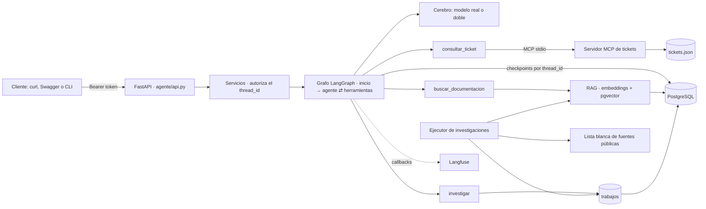

# Arquitectura del proyecto final

## Vista general

## Un turno, paso a paso

1. La API valida el cuerpo (`thread_id`, `mensaje`) y traduce el token a un usuario.
2. `Servicios.conversar` comprueba que la conversación es de ese usuario (tabla `conversaciones`).
3. El grafo carga el estado del hilo desde el checkpointer y añade el mensaje.
4. `agente` llama al cerebro con el prompt de sistema y el historial.
5. Si el cerebro pide herramientas, `herramientas` las ejecuta —lista blanca, validación de
   argumentos y límite por turno— y vuelve a `agente`.
6. Cuando el cerebro responde sin pedir herramientas, el turno termina y el estado se guarda.
7. La API devuelve respuesta, ruta, herramientas, fuentes y `request_id`, y se escribe una
   línea JSON de log.

## Decisiones y por qué

| Decisión | Por qué | Alternativa descartada |
|---|---|---|
| Grafo explícito de tres nodos | Se ve y se prueba cada transición | Agente prefabricado: oculta el bucle |
| Cerebro inyectable (real o doble) | Tests y práctica sin claves ni coste | Simular respuestas dentro del grafo |
| Tickets solo por MCP | El sistema de negocio tiene su propio contrato | Leer el JSON desde el agente |
| MCP por stdio, un proceso por llamada | Se ve el protocolo completo; nada que desplegar aparte | Sesión persistente o servidor HTTP: mejor en producción |
| Lista blanca de herramientas en el cliente | El servidor puede publicar más de lo que queremos usar | Confiar en lo que publique el servidor |
| Umbral de evidencia en la recuperación | Rechazar es una salida válida | Responder siempre con el mejor fragmento |
| Investigación como trabajo con estado | Puede tardar más que una petición; no se pierde ni se duplica | Tarea en memoria de FastAPI |
| Clave idempotente `thread_id + tema` | Repetir la petición no crea otro trabajo | Un trabajo por petición |
| Lista blanca de fuentes públicas | Investigación acotada y reproducible | Búsqueda web abierta: extensión posible |
| Propiedad de la conversación en una tabla | `thread_id` no autoriza | Fiarse del identificador |
| 404 para conversación ajena | No se confirma que exista | 403 |
| API síncrona (`def`) | Un solo camino de ejecución, fácil de seguir | Todo asíncrono: mejor a mayor escala |

## Tablas de PostgreSQL

| Familia | Tablas | Quién las crea |
|---|---|---|
| Memoria del grafo | `checkpoints`, `checkpoint_blobs`, `checkpoint_writes`, `checkpoint_migrations` | LangGraph (`setup()`) |
| Autorización | `conversaciones` | `esquema.sql` |
| Conocimiento | `fragmentos` (con `vector(768)` e índice HNSW) | `esquema.sql` |
| Investigaciones | `trabajos` | `esquema.sql` |

## Límites que están en el código

| Límite | Valor por defecto | Dónde |
|---|---|---|
| Herramientas por turno | 4 | `grafo.py` |
| Pasos del grafo (`recursion_limit`) | 2 × herramientas + 6 | `observabilidad.py` |
| Espera de una llamada MCP | 10 s | `mcp_cliente.py` |
| Consultas por investigación | 3 | `investigacion.py` |
| Fuentes por investigación | 3 | `investigacion.py` |
| Bytes por fuente | 1,5 MB | `investigacion.py` |
| Tiempo por investigación | 30 s | `investigacion.py` |
| Longitud del mensaje | 2.000 caracteres | `api.py` |

## Qué queda fuera a propósito

Interfaz web, voz y multimodal, streaming de la respuesta, búsqueda web abierta, sistema de
autenticación real, multiagente y facturación. Son extensiones posibles; no hacen falta para
cubrir el temario del proyecto final.
